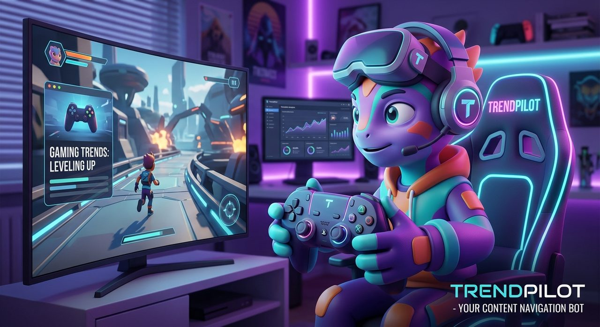

<p align="center">
  
</p>

<h1 align="center">TrendPilot</h1>
<p align="center"><b>Know what's trending, when to go live, and how to word your post, all from Discord.</b><br>
Free and open source. Runs quietly in the background while you stream.</p>

<p align="center">
  <a href="https://github.com/Mathiew1618/trendpilot/releases/latest"><b>⬇️ Download</b></a> ·
  <a href="docs/SETUP.md"><b>Setup guide</b></a> ·
  <a href="#-will-it-slow-down-my-stream">Will it slow my stream?</a> ·
  <a href="#-questions">Questions</a>
</p>

---

## What it does

TrendPilot is a bot that lives in your Discord server. Ask it a question with a slash command and it answers from **live Twitch and YouTube data**.

| Ask it | You get |
|---|---|
| `/games` | Games trending on Twitch **right now**, how many people are watching each, and which ones a smaller channel can actually get noticed in |
| `/genres` | Which genres are pulling viewers today (shooters, RPGs, horror…) |
| `/besttime` | The best hours **for you** to go live or post, in your own time zone |
| `/viewers` | Is Twitch busier or quieter than an hour ago? What's rising and what's fading? |
| `/trends` | Hashtags and topics trending on YouTube that are still early (rising, not yet crowded) |
| `/suggest` | Paste your title or caption and get 3 better versions plus hashtags that fit current trends |
| `/watch` | Paste a YouTube link. TrendPilot messages you when new comments come in (reply while it counts) or when the video starts taking off |
| `/raid` | Small live channels in your game (3–30 viewers) that a raid would really help, with a **Raid** button |
| `/clip` | Clip the last 30 seconds of your stream right now |

### It also works on its own while you stream

You don't have to ask. Pick a channel for each update with `/sendhere`, and TrendPilot posts by itself:

| Update | What lands in Discord |
|---|---|
| **Trend alerts** | *"📈 **Horror** spiked **+250%** in the last 20 min (4k → 14k viewers)."* Spot a wave while it's starting. Each alert has a **Mute 24h** button. |
| **Go-live announcements** | A fresh, AI-written announcement every time you go live, instead of the same `@everyone` text every day. You choose which role gets pinged, if any. |
| **Clips & highlights** | When your chat suddenly explodes (*"CLIP IT"*, *"NO WAY"*, *"LUL"*), TrendPilot clips the moment on Twitch, saves your OBS replay buffer if you use one, writes a short-form title and hashtags, and posts it for you to **Approve**, ask for a **New title**, or **Discard**. Approved ones come with the title and hashtags ready to copy into TikTok, Shorts or Reels. |
| **Stream recap** | When you end the stream: how long you streamed, your peak viewers, and every highlight with its timestamp. |

Nothing is posted to TikTok, YouTube or anywhere else without you. You approve every clip, and raids only start when you press the button.

<details>
<summary><b>Example: <code>/games</code></b></summary>

```
Trending on Twitch now (412k viewers in the top 30 categories)
1. Just Chatting → 98k viewers · 200+ channels · Non-gaming
2. Grand Theft Auto V ↑ 41k viewers · 200+ channels · Shooter/Racing
3. Hollow Knight: Silksong ↑ 22k viewers · 200+ channels · Platform/Adventure · ▶️ 3 on YouTube trending
…

Best openings for a growing channel (big audience, low bar to reach the first screens)
1. Hollow Knight: Silksong: 22k viewers, ~35 viewers gets you top 25, rising 18%/h
2. Hades II: 9.1k viewers, ~14 viewers gets you top 25
…
```
*(Illustration of the format. Your numbers come from live data.)*
</details>

### How "best openings" works

A huge game isn't automatically a good choice. If the 25th-biggest stream has 2,000 viewers, nobody scrolling the directory ever reaches you.
TrendPilot looks for games with **lots of viewers where a small stream can still appear near the top of the directory**, and gives extra credit to games that are rising right now.

---

## ⬇️ Get started (about 15 minutes, once)

1. **Download** the file for your computer from the [Releases page](https://github.com/Mathiew1618/trendpilot/releases/latest):

   | Your computer | Download |
   |---|---|
   | Windows | `trendpilot_…_windows_amd64.zip` |
   | Mac with Apple chip (M1, M2, M3, M4) | `trendpilot_…_darwin_arm64.tar.gz` |
   | Older Intel Mac | `trendpilot_…_darwin_amd64.tar.gz` |
   | Linux | `trendpilot_…_linux_amd64.tar.gz` |

2. **Unzip it** and **double-click `trendpilot`**.
3. **Follow the setup.** It walks you through getting four free keys (Discord, YouTube, Twitch and an AI writer), checks each one works, and gives you the link to add the bot to your server. Optional extras: your Twitch channel (for clips, go-live posts and raids) and OBS (to save replays).
4. **In Discord, pick your channels:** type `/sendhere` in the channel where you want each kind of update.

After that, double-click TrendPilot whenever you want it running. That's it.

> **Stuck on a step?** The [setup guide](docs/SETUP.md) goes through each one in detail.
> **Windows says "Windows protected your PC"?** Click **More info → Run anyway**. That appears for any new app that isn't from a big publisher.
> **Mac says it can't be opened?** Open **System Settings → Privacy & Security**, scroll down, and click **Open Anyway** next to TrendPilot. You only need to do this once.

---

## 🎮 Will it slow down my stream?

**No.** TrendPilot was built for exactly this worry.

### What it uses

<!-- METRICS:START -->
Measured over 30 minutes doing everything at once: scanning the top 30 Twitch categories and YouTube's trending charts every 10 minutes, following **one of Twitch's busiest live chats** (a worst case; your chat will be quieter), and tracking a YouTube video. Numbers come from the operating system, sampled every 2 seconds.

| | TrendPilot | What that means |
|---|---|---|
| **CPU** | **0.15%** of one core on average | A short blip to about 6% for 2 seconds every 10 minutes while it scans. The rest of the time it's asleep. |
| **Memory** | **15 MB** (17 MB at most) | Less than a single browser tab. |
| **Upload** | **≈0.5 kbps** | Streaming is limited by your upload. A 6,000 kbps Twitch stream is about **12,000×** more. |
| **Download** | **≈72 kbps** (33 MB an hour) | About what a music stream at low quality uses. A quiet chat brings it lower. |
| **Disk** | One small file of hourly viewer averages | Nothing is written while you stream except that file, once an hour. |

<sub>Measured 14 Oct 2026 on a 2-core cloud Linux machine (GitHub Codespace). 244 API requests, 0 failures. Your own numbers appear in TrendPilot's window every hour.</sub>
<!-- METRICS:END -->

### Why it can't get in your stream's way

- **It runs at low priority.** Your computer always serves OBS, your game and your encoder first. TrendPilot only gets the leftovers.
- **It's limited to one CPU core**, even on a 16-core machine.
- **It has a memory ceiling of 150 MB**, less than a single browser tab.
- **It mostly sleeps.** It wakes up every few minutes, makes a handful of small requests, and goes back to sleep.
- **It doesn't touch your stream.** It never reads your video or audio and never uploads anything big. Chat is read as plain text. If you connect OBS, TrendPilot only sends it one tiny "save replay" message when chat surges, and only connects for that moment.
- **You can check it yourself.** It writes its own CPU, memory and data use to its window every hour.

---

## 🔒 Privacy and fair play

- **Your keys stay on your computer** in a file called `trendpilot.env`. TrendPilot has no server of its own and collects nothing.
- **The only thing saved to disk** is a small file of hourly viewer averages per game, which is how `/besttime` learns. It contains no personal data.
- **TrendPilot never posts, likes or comments on social platforms for you.** Fake engagement breaks every platform's rules and can get your channel restricted. TrendPilot tells you when to act, and you do it yourself.
- **Twitch sign-in is optional** and only asks for two permissions: making clips of *your* stream, and starting a raid *when you press Raid*. Only members with **Manage Server** can use the clip, raid and settings buttons.
- **Chat is read anonymously**, the same way a logged-out viewer sees it, and is never stored.
- **It only suggests hashtags that fit your content.** Trending tags that don't fit are listed as skipped, because off-topic tags get posts marked as spam.

---

## ❓ Questions

<details><summary><b>Does it cost anything?</b></summary>

TrendPilot itself is free. All four keys have free tiers that are plenty for one creator: YouTube gives 10,000 requests a day and TrendPilot uses about 600, and Twitch and Discord are free. For the AI writer, Groq has a free tier, or you can run Ollama on your own computer for free.
</details>

<details><summary><b>Do I have to leave my computer on?</b></summary>

TrendPilot only works while it's running. Most people start it when they sit down to stream or edit. `/besttime` gets smarter the more hours it has seen, so leaving it running for a week gives the best results. A spare laptop or a Raspberry Pi works great for that.
</details>

<details><summary><b>Why does <code>/besttime</code> say "still learning"?</b></summary>

Twitch doesn't publish viewer history, so TrendPilot builds its own by checking every 10 minutes. You get useful answers after a few hours and full weekly patterns after about 7 days. That history is kept between restarts.
</details>

<details><summary><b>Does it work for TikTok or Instagram?</b></summary>

`/suggest` writes captions and hashtags for TikTok, Instagram, YouTube and Twitch. The live trend data comes from YouTube and Twitch, because TikTok and Instagram don't offer public trend data to independent apps.
</details>

<details><summary><b>Can my mods use it?</b></summary>

Yes. Anyone in your Discord server can use the commands. Alerts from `/watch` go to the channel where it was run.
</details>

<details><summary><b>Why didn't a big moment get clipped?</b></summary>

TrendPilot clips when chat moves much faster than usual, so it learns your chat's normal pace during the first couple of minutes of each stream. Clips also need you to have signed in to Twitch during setup (or run `trendpilot twitch-login` later), and clips must be enabled on your channel. You can always use `/clip` yourself.
</details>

<details><summary><b>How do I stop it?</b></summary>

Close its window, or press Ctrl+C in it.
</details>

---

## For developers

TrendPilot is written in Go: a single file, no installer, no background services. See [docs/DEVELOPING.md](docs/DEVELOPING.md) to build it, run the tests, or contribute.

Released under the [MIT License](LICENSE).
